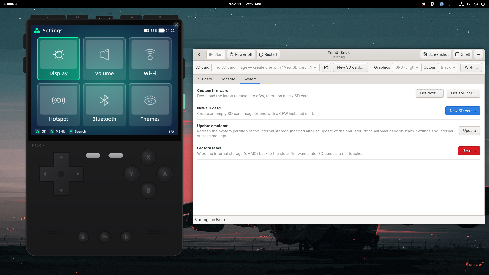
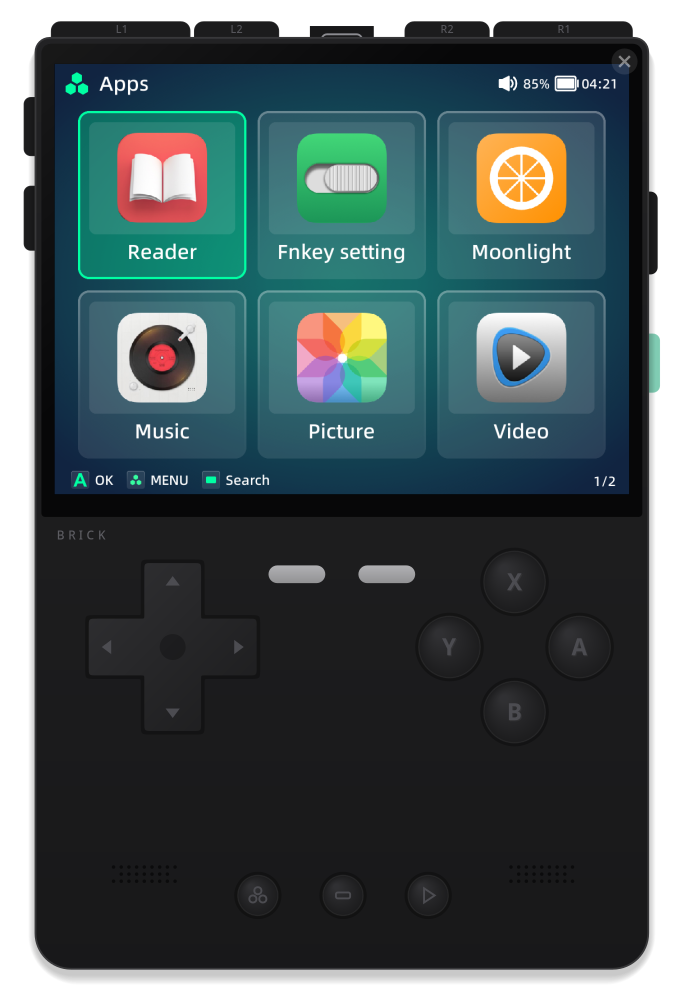
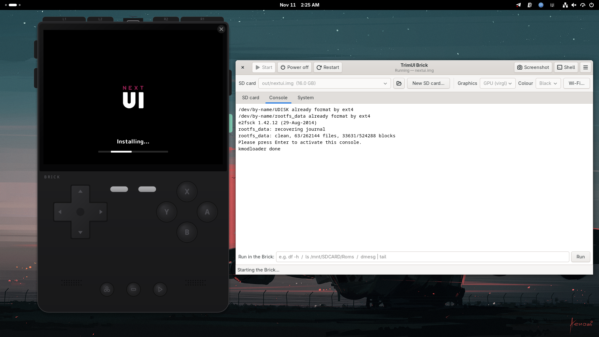
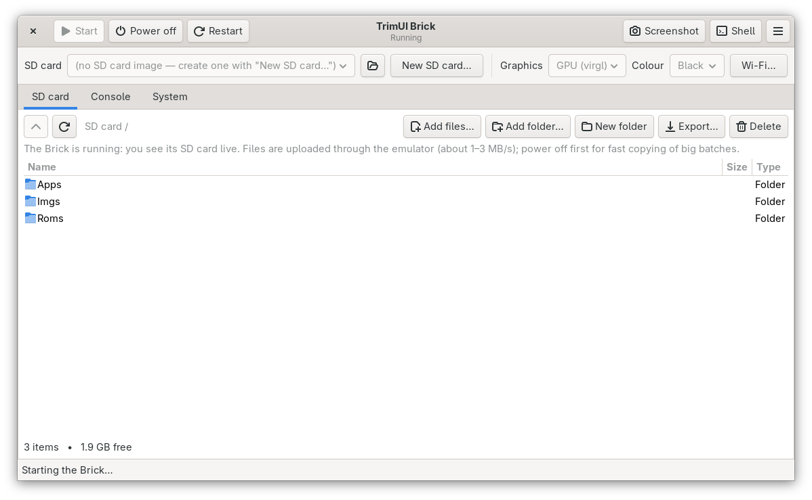
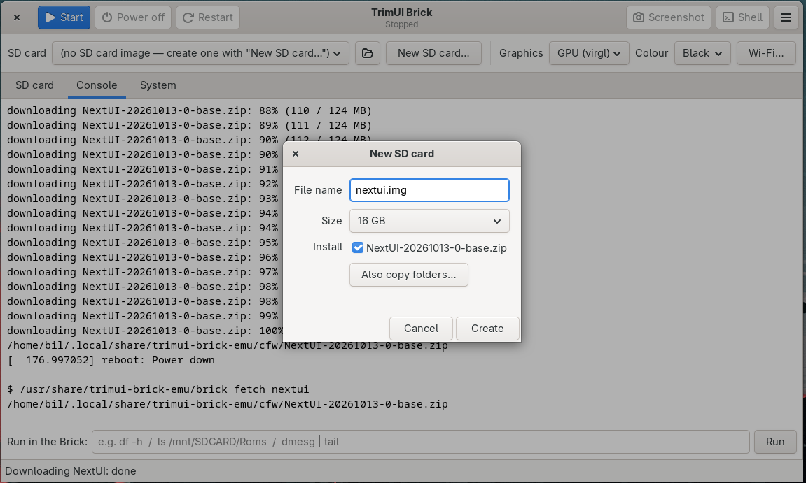
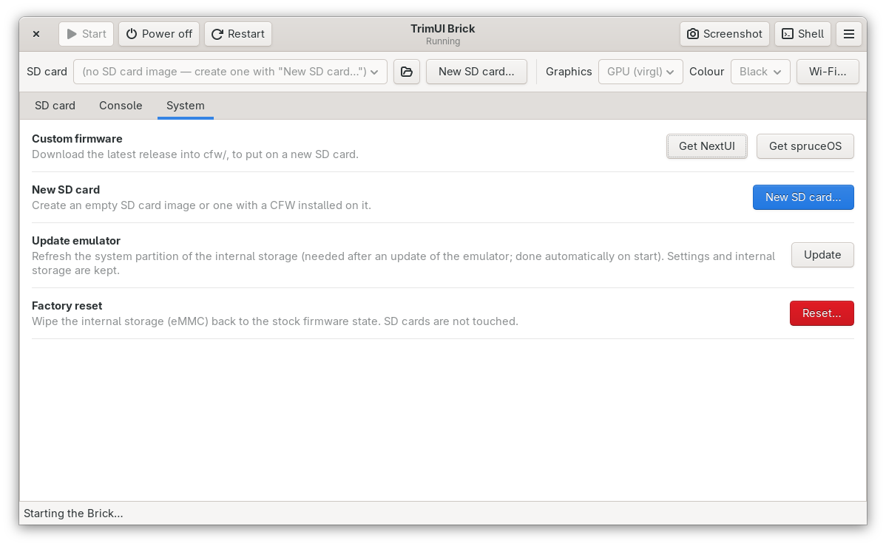

# TrimUI Brick Emulator

Run the **TrimUI Brick** handheld on your Linux PC: the official TrimUI
firmware boots in an emulated Brick. Custom firmwares that install on top of it,
such as **NextUI** and **spruceOS**, then run unmodified, just as they do on the
real device. It's handy for trying out CFWs, themes and settings, developing
apps and paks, or managing an SD card without touching your handheld.



<p align="center">
  
  &nbsp;
  
</p>

## Features

- **The real firmware, unmodified.** The stock TrimUI OS (Tina Linux) boots on
  an emulated 8 GB eMMC with the original partition layout. CFWs are installed
  from the SD card the same way as on the device.
- **A window shaped like the Brick.** Every button can be clicked: D-pad,
  A/B/X/Y, L1/L2/R1/R2, MENU, SELECT, START, F1/F2, volume and power.
  Pressed buttons light up, right-click holds a button down for combos, and
  the window comes in three colours (black, grey, white).
- **Keyboard and gamepad controls.** See [Controls](#controls).
- **GPU acceleration.** OpenGL ES rendering is done on your graphics card
  (virgl), and NVIDIA's driver works too. A software renderer is the fallback.
- **Simulated Wi-Fi.** The Brick finds a Wi-Fi network called `BrickNet` in its
  own Wi-Fi menu. It can connect with a password and gets internet through
  your PC. Without Wi-Fi it has no network, just like the real device.
- **A manager window** for everything else:
  - Start, power off (a clean shutdown inside the firmware), restart.
  - Browse the SD card and add files or folders, by button or by dragging them
    in from your file manager. Also export, delete and create folders. This
    works while the Brick runs too.
  - Create SD cards with NextUI or spruceOS preinstalled, and download them
    with one click.
  - Screenshots, a root shell, the boot console, Wi-Fi settings, factory reset.
- **Sound** through your PC's speakers.
- **Brick hardware details** that CFWs check for: the battery, the power key,
  the LED and rumble controls, the serial number in `/proc/cpuinfo` and the
  display ioctls.

| SD card | New SD card | System |
|---|---|---|
|  |  |  |

## Install

**Fedora** (x86_64; the package is architecture-independent): download the
`.rpm` from the [releases page](https://github.com/imrmnabil/trimui-brick-emu/releases),
then

```bash
sudo dnf install ./trimui-brick-emu-*.noarch.rpm
```

dnf installs everything it needs: Fedora's QEMU, Python/GTK and the disk tools.

**Other distributions** (Ubuntu, Debian, …): build from source. See
[BUILD.md](BUILD.md).

## Getting started

1. Open **TrimUI Brick Emulator** from your applications menu, or run
   `trimui-brick-emu`.
2. On first start the manager offers to **set up the Brick**. This downloads
   the stock firmware (about 120 MB) from
   [TrimUI's GitHub releases](https://github.com/trimui/firmware_brick/releases)
   and creates the emulated internal storage. The firmware isn't included in
   this project.
3. **System → Get NextUI** (or spruceOS), then **New SD card…**. Choose a size,
   tick the CFW and create the card.
4. Choose the card at the top and press **Start**. A CFW's first boot runs its
   installer, as on hardware. NextUI takes a few minutes in the emulator.
5. Add your ROMs in the **SD card** tab, under `Roms/<system>/`. If you power
   the Brick off first, files are copied straight into the image at full speed.

Your data (internal storage, SD cards, downloads) is kept in
`~/.local/share/trimui-brick-emu`.

## Controls

| Brick | Keyboard |
|---|---|
| D-pad | arrow keys |
| A / B / X / Y | X / Z / S / A |
| L1 / R1 / L2 / R2 | Q / W / E / R |
| START / SELECT | Enter / Right Shift (or Backspace) |
| MENU | Esc (or M) |
| F1 / F2 | 1 / 2 |
| Volume + / − | = / − |
| Power | P (or End) |

Mouse controls in the window:

- **Left-click** a button to press it.
- **Right-click** holds a button down until you right-click it again.
- **Drag** the body to move the window, and **Ctrl + wheel** to zoom.
- The **✕** at the top right, or **Ctrl+Q**, powers the Brick off.

Gamepads passed through to the emulator use the standard layout.

## Wi-Fi

| | Default | Change in |
|---|---|---|
| Network name | `BrickNet` | manager → **Wi-Fi…** (or `--wifi-ssid`) |
| Password (WPA2) | `brick1234` | manager → **Wi-Fi…** (or `--wifi-pass`, empty = open network) |
| Router | on | manager ☰ → **Wi-Fi router on / off** |

Once the Brick is on Wi-Fi, SSH into it at `127.0.0.1:2222`.

## Command line

```bash
trimui-brick-emu                         # the manager
trimui-brick-emu run [SD.img] [options]  # boot straight into the Brick window
trimui-brick-emu run --gpu virgl         # GPU rendering (the manager's default)
trimui-brick-emu shell                   # root shell on the running Brick (Ctrl-] detaches)
trimui-brick-emu sd OUT.img 16G NextUI-*.zip [folders…]   # build an SD card image
trimui-brick-emu fetch nextui|spruce     # download a CFW
trimui-brick-emu reset                   # factory-reset the internal storage
```

In a terminal started with `run`, the terminal is the Brick's serial console,
and `Ctrl-a x` quits.

## How it works

```
Brick firmware (Tina Linux, unmodified) on an emulated eMMC + your SD card image
        │  runs on
QEMU "virt" arm64 machine (4 × Cortex-A53, 1 GB) with a small Linux 6.6 kernel
        │  whose brick-hw driver plays the Brick's hardware
        │  (buttons, PMIC/battery, LEDs, rumble, display engine)
GLES apps ─► EGL shim ─► Mesa (virgl on your GPU, or llvmpipe) ─► framebuffer
        │
Brick-shaped window (GTK) ◄── screen over local VNC, buttons back as keys
```

The stock root filesystem is left as it is, apart from a small startup hook. That
hook mounts the emulator's add-on disk (Mesa, the EGL shim, the Wi-Fi
simulation) and points the PowerVR GLES libraries at Mesa. Wi-Fi uses
`mac80211_hwsim`: one virtual radio is the Brick's `wlan0`, and the other is a
hidden access point run by the firmware's own `hostapd`, bridged to QEMU's
network.

## Limitations

- **The Brick is an ARM device, so QEMU translates every instruction.** Menus
  and app start-up are noticeably slower than on hardware. Use GPU mode for
  anything graphics-heavy.
- **The emulated Brick needs about 1 GB of RAM** on top of your desktop.
  If RAM runs short it gets swapped out and seems to freeze, so close some
  browser tabs.
- **Sleep is simulated.** When the firmware or NextUI puts the Brick to sleep,
  it stays asleep until you press the power button (the side button, or `P`),
  but the PC doesn't actually suspend it.
- **Not reproduced:** Bluetooth, the LEDs (their state is stored but not shown)
  and rumble.
- **Stock OTA updates** work, but run System → Update afterwards.

## License

The project's own code is licensed under the [GNU GPL v2](LICENSE). Release
packages also contain a Linux kernel and arm64 Mesa libraries from Debian:
see [THIRD_PARTY.md](THIRD_PARTY.md).

This is an independent project, not affiliated with or endorsed by TrimUI.
"TrimUI" and "Brick" are used only to name the device being emulated. The
TrimUI firmware is downloaded from TrimUI's own releases and isn't
redistributed here.
